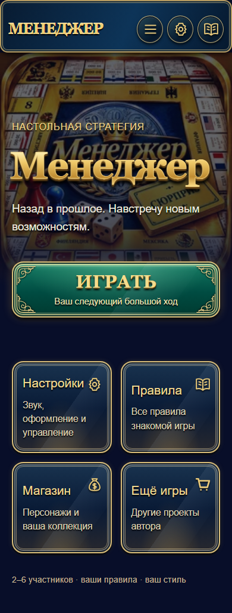

# Приёмка после Stage 1 — обновлено 25 ноября 2026

## Свежая аутентифицированная инвентаризация VPS — 25 ноября 2026

**SSH PASS:** команда владельца `ssh -o BatchMode=yes manager-vps "whoami && hostname"` вернула root / 20491.online-vds.ru. Ключ разблокирован агентом; файл приватного SSH-ключа не читался/не копировался. Предыдущий auth blocker устранён. Собраны только разрешённые метаданные; удалённый Python передан stdin, PYTHONDONTWRITEBYTECODE=1, файлов аудита на VPS не создавалось. SQL-соединений/запросов к рабочим БД не было: прочитан только 100-байтный SQLite header с O_RDONLY/O_NOATIME и stat DB/WAL/SHM. Секреты, initData, пользовательские строки и полные env/unit/journal не выводились.

Проверенный HEAD до этого документационного обновления **6ab71c05f1e06f916e67e4211f4c419e19d16c39**, кандидат **cae45deece158ed41c30d3c9d7a49a1a0c4f237d**, PeerServer **536009173cf47ba47687777548d7dc161d7de30e**. PR №7 и №1 OPEN/Draft/MERGEABLE. Ни тесты, ни сборки/CI не повторялись. Пакет cae45de и внешний SHA-256 повторно сверены: **3424eca6ca9b9156c872befa316b2b08d28c3b02cdbadcdc2a8b17864437e537**, целостность PASS.

| Параметр | Фактическое состояние | Сравнение/действие |
|---|---|---|
| Installed release | Оба RELEASE.json объявляют **17710830aa22b9cac3d17a163a3feb7dbbcd8382**; current — symlink на старые release directories | Не cae45de. Telegram server модифицирован: blob dff8ad6… совпадает с /start-fix e98a25d, тогда как Store совпадает с 1771083. Единого неизменённого Git tree у установки не подтверждено |
| Rooms | manager-online.service active/running/enabled, User=manager-online, 127.0.0.1:8080, ROOM_EXTENSION=telegram | Single shared room writer сохранён; server blob совпал с 1771083, отличается от кандидата |
| Adapter | manager-telegram.service active/running/enabled, User=manager-telegram, 127.0.0.1:8443 + приватный 8444, mode=adapter, roomsEnabled=false | Разделение архитектуры фактически подтверждено |
| Poller | manager-telegram-poller.service active/running/enabled, Requires=manager-telegram.service, User не задан (root); код poller совпал с cae45de | Unit active не означает работающий Bot API: 30 getUpdates HTTP 401 за последние 15 минут |
| Node/Python | Node **v24.22.2**, Python **3.11.2** | Соответствуют требованиям кандидата; установка/обновление зависимостей не нужны по этим версиям |
| Ресурсы | Доступно **1.23 GiB RAM**, **3.01 GiB диска**, swap отсутствует | Порог memory/disk существующего release guard на этом снимке пройден: RAM≥256 MiB, расчётный disk минимум 1 GiB. Перед будущим apply проверяется заново |
| Rooms SQLite | /var/lib/manager-online/rooms.sqlite, 7,356,416 B; WAL 4,231,272 B; SHM 32,768 B; права 0600 | Header SQLite/WAL подтверждён, SQL/целостность/строки не читались |
| Telegram SQLite | /var/lib/manager-telegram/telegram.sqlite, 4,096 B; WAL 1,133,032 B; SHM 32,768 B; права 0600 | Существенные данные находятся в WAL; нельзя копировать один sqlite. Backup/restore в этой read-only задаче не выполнялся |
| Stars/AdsGram flags | В selected config И окружении running adapter/poller **STARS_ENABLED=0**, **ADS_VERIFIED_GATEWAY_ENABLED=0**; Block ID не задан; health starsConfigured=false/adsConfigured=false | Фактические OFF-флаги PASS. Дополнительный monetization-off env patch сейчас не нужен |
| Installed OFF guard | Установленный Telegram server не содержит исправления pending pre-checkout | Новые invoice скрыты/отключены, но старый unpaid invoice на deployed коде имеет ранее воспроизведённый OFF-риск. Исправлен только в кандидате cae45de, пока не развёрнут; реальных checkout/payment запросов не выполнялось |
| Telegram namespace | В adapter/poller **TELEGRAM_ENV=test**; read-only Bot API в этой среде →401 | Это подтверждённое несоответствие среды, не вывод о недействительном токене |
| Identity/webhook | Тот же токен в обычной среде getMe OK, identity соответствует @ManagerGameTestBot; getWebhookInfo OK, URL пуст, pending updates=3 | Polling выбран корректно вместо webhook, но работает с неправильным API prefix. getUpdates/deleteWebhook/setWebhook/sendMessage не вызывались |
| URL/routes | HTTPS manager.95-181-169-84.sslip.io/health →200 с VPS **и внешнего Windows-клиента**; legacy health →200; /api/rooms без кода →штатный400; /internal/cosmetics/verify →404 | Доверенный TLS, базовая маршрутизация/закрытие private path PASS; игровых команд не отправлялось |
| Caddy/Docker/Смайлокрут | caddy.service и docker.service active; active Caddy manager routes ведут на 8080/8443, не 8444; Смайлокрут 127.0.0.1:18080 →200 | Только чтение systemctl/active-config/HTTP; ни Docker CLI mutations, ни restart/reload/config write не выполнялись |
| Rollback helpers | Installed poller blob совпадает с кандидатом; backup.sh SHA-256 **a3305e68ffb9a8415f2bc496c437d34090414fa07fbaf3f8b483519fb52921db** совпадает | Предпосылка сохранения доверенного poller/backup helper пройдена. Старый Store/room code отличаются, реальная DB compatibility/recovery ещё не подтверждена |

### Свежий GO/NO-GO для cae45de

**NO-GO на code-only rollout с текущей конфигурацией.** Главный новый подтверждённый blocker: test API namespace даёт 401, а обычный Bot API работает. Простое переключение current на cae45de сохраняет этот неверный env; health=true и active poller не доказывают доставку Telegram updates. Перед будущим apply нужен отдельный операционный gate успешного Bot API auth/работоспособности polling, не только is-active.

Минимальное необходимое конфигурационное исправление после **отдельного разрешения** — TELEGRAM_ENV=production (имя обычной Bot API-среды, **не включение Stars/AdsGram**) в фактически используемом adapter.env/окружении двух Telegram-служб. Оба OFF-флага и абсолютный TELEGRAM_DATABASE сохраняются; Caddy/Docker/room database и Bot API webhook не менять. В этой задаче исправление НЕ применено, службы НЕ перезапускались. Исторический тестовый namespace может быть сохранён только для настоящего отдельного Telegram test-bot, но этот установленный токен read-only getMe подтвердил обычную среду.

Кандидат cae45de уже исправляет отдельный deployed OFF pre-checkout defect (ранее 1 targeted PASS + 7 packaged PASS). Ни новые неоплаченные invoice, ни webhook/платёжные операции не создавались на VPS. Прежние 19 UI, 11 backup/rollback и применимые CI сохранены. Подтверждённые receipts/refunds не отключаются при OFF — это нужно для сохранности прежних покупок.

Второй незакрытый gate: свежий изолированный GO обеих exact cae45de-архивов с фактическим старым runtime/согласованными копиями обеих БД и проверенным восстановлением. WAL header/health не являются integrity_check или restore PASS. В текущем разрешении только чтение: копии, восстановление, миграции и тестовые игровые записи не делались. 11 прежних synthetic recovery PASS применимы к инструменту, но не заменяют эту проверку.

Полная реальная приёмка новых WebView/Android/iPhone/двух аккаунтов остаётся BLOCKED; исторический Desktop roll 2+3=5 не повторялся. PeerServer 5360091 технически GO, его production-обновление не требуется ради cae45de. Оба PR Draft, game merge по полной приёмке/тестовый выпуск на этом VPS/production — NO-GO до закрытия либо явно согласованного scope оставшихся gates.

**Следующие разрешённые шаги до выпуска:** отдельно согласовать узкое исправление Telegram API namespace и перезапуск только adapter/poller с сохранением данных/флагов OFF; затем получить свежий изолированный GO/verified backup-restore для actual installed runtime→cae45de, решить внешнюю реальную приёмку и отдельно разрешить merge/deployment. Разрешение текущей задачи на read-only доступ не считается разрешением этих изменений. Публичные GET и getMe/getWebhookInfo — единственные запросы; offset/updates не потреблялись.

Ни production-код/current, ни конфигурации/env, ни unit/state, ни Caddy/Docker/Смайлокрут, ни SQL/записи DB/WAL/SHM нашими действиями не изменены. Выполнена только инвентаризация и обновление локального отчёта.

## Предыдущие проверки и исторические решения

Разделы ниже сохраняют историю; прежняя блокировка SSH устранена и больше не является текущей причиной NO-GO.

## Актуальный итог: первый выпуск с монетизацией OFF

25 ноября. Начальный HEAD этого продолжения был **004646bc682490908ffc9d0ef2c41ce06a002963**. После подтверждённого runtime-исправления новый принятый кандидат — **cae45deece158ed41c30d3c9d7a49a1a0c4f237d**; PeerServer по-прежнему **536009173cf47ba47687777548d7dc161d7de30e**. Документационный HEAD после этого кандидата не меняет runtime. Game: `feature/all-platform-ui-stage1` → `fix/telegram-start-20261119`; Peer: `test/signaling-contract` → `main`. Оба PR остаются Draft/MERGEABLE. Прежние разделы о f6c84f2 ниже — история аудита, не текущий кандидат.

### Исправленный обязательный дефект OFF

Воспроизведено локально: при Stars OFF старый неоплаченный invoice получал `answerPreCheckoutQuery(ok=true)`, поскольку обработчик webhook не проверял starsReady. Новые invoice были закрыты, но pre-checkout оставался открытым. Минимальное исправление только в telegram/server.cjs: при !starsReady вернуть отказ до store.checkout. На исходном коде новый тест FAIL (true вместо false), после исправления PASS. Игровой движок, RNG, экономика, профили, схема и формат сохранений не изменены.

**OFF фактически PASS в изолированном тесте** с process.env из подготовленного monetization-off.example: features.stars/ads=false; новые invoice/ads begin → 503; старый pending checkout отклонён без выдачи права; чужой webhook → 403. Прежняя постоянная покупка пережила рестарт; подтверждённый ранее in-flight successful_payment доставляется/сохраняется даже после OFF; refund отзывает только соответствующее право. Все платежные данные синтетические, Bot API заменён mock, реальных списаний/возвратов/рекламных наград нет. Подтверждённые финансовые события нельзя терять из-за OFF; это не разрешение новой оплаты.

Подготовлены, но НЕ применены `monetization-off.example` и `monetization-off.conf.example`: дополнительный env только с двумя OFF-флагами добавляется последним EnvironmentFile существующего adapter unit. Environment=0 само по себе может быть перекрыто EnvironmentFile; порядок и SHA всех фактических env контролирует существующий release-update.py. Если production уже OFF — патч не нужен. Если ON — установка патча/изменение unit/перезапуск только после отдельного разрешения; токены/webhook/polling не меняются. Этот шаблон проверен в изолированном server fixture, не в настоящем systemd на VPS.

Первый выпуск OFF уже выбран владельцем этим заданием, повторного согласования варианта не требуется. Реальные коммерческие Stars/AdsGram-сценарии **вне scope первого OFF-выпуска**, а не обязательная незакрытая коммерческая интеграция. Однако фактические production OFF/health и сохранность реальных старых покупок после обновления остаются BLOCKED вместе с отсутствующей инвентаризацией/GO VPS.

### Новый пакет и единственный заключительный прогон изменённого runtime

Упакованы два точных cae45de-архива из существующих ресурсов; UI/нативные сборки и npm install не запускались. Сравнение всех tar members с f6c84f2: rooms отличается только RELEASE.json; adapter — только RELEASE.json и telegram/server.cjs. Prestige, все функции меню, поле/анимации, poller, Store/catalog и сетевой код byte-identical прежнему кандидату.

**8 актуальных PASS / 0 FAIL:** 1 новый целевой OFF-тест и один финальный packaged E2E-прогон 7/7 нового cae45de (меню, локальная партия/reopen, два синтетических клиента, чат/unread/read, reload, offline/reconnect/state sync, без двойного хода и платежных записей). Прежние 18/19/11 и 12 CI повторно не запускались; их область применимости сохранена для неизменённых модулей. Новый GitHub CI на текущем HEAD не объявлен зелёным: commits используют skip ci.

Единственный текущий пакет: `release-output/release-cae45de/manager-release-cae45de.zip`, **44,913,121 байт**, SHA-256 **3424eca6ca9b9156c872befa316b2b08d28c3b02cdbadcdc2a8b17864437e537**. Рядом внешний .sha256; внутри SHA256SUMS, shared-release/release-candidate manifests, оба tar, проверенные существующие release tools, новый pinned plan и неактивные OFF-шаблоны/инструкция. Рабочих env/БД/секретов нет. Старые f6c84f2 ZIP сохранены только исторически: **не использовать для первого OFF-выпуска**. Любой прежний VPS GO относится к старым SHA; нужен новый GO cae45de.

- Rooms SHA-256: `24e5973f9909b4ad683a8b5c51a5cbbb07bbd479d4c06bfe9b437beabcac4dcc`.
- Adapter SHA-256: `00fbc3d25fe1fc46c4056c9b4503d411ab49f03a3b06163bdbe577961b76f491`.

### Read-only инвентаризация и реальные среды

Доступ впоследствии восстановлен через разблокированный Windows ssh-agent: root-вход manager-vps подтверждён, свежая read-only инвентаризация вынесена в начало отчёта. Предыдущие SSH-блокировки устранены; нынешний NO-GO связан с Telegram API namespace и незавершённым live-data recovery/реальной приёмкой. Секреты/содержимое игровых БД VPS не читались. Локальная PnP-инвентаризация не обнаружила Android/ADB/iPhone, adb не запущен; настройки устройств не менялись. Прежние неработающие geometry/keyboard/CDP способы Telegram-ввода не повторялись; разрешённые Web/второй аккаунт не подтверждены, новые логины/коды не запрашивались. Реальное наблюдение Desktop меню/броска 2+3=5 относится к старому a3279b0, не новому cae45de.

| Параметр | Текущее состояние | Требуемое | Действие |
|---|---|---|---|
| Installed SHA/current directories | BLOCKED | Фактические targets/hashes и совместимость с cae45de | Приватная read-only инвентаризация через разрешённый доступ |
| rooms/adapter/poller и зависимости units | Известны со слов владельца; сейчас BLOCKED | Active, прежний single poller, точные unit/drop-in/env pins | Чтение systemctl metadata, без restart/изменений |
| Node/порты/RAM/диск | Раньше сообщён Node 24.22.2; сейчас BLOCKED | Node >=24.22.1 <25; 8080/8443/8444, headroom по release guard | Только чтение состояния |
| SQLite paths/WAL/сохранения | Ожидаются /var/lib/manager-online и /var/lib/manager-telegram; BLOCKED | Подтверждённые пути/WAL, свежий согласованный backup и isolated restore | Metadata без пользовательских строк; backup только в разрешённое окно |
| Domain/routes/Caddy/Docker/Смайлокрут | Сейчас не проверены | Прежняя маршрутизация/health, без изменений общих служб | Разрешённое read-only наблюдение |
| Production Stars/Ads OFF | BLOCKED | Effective env + health OFF, отсутствие разрешённых новых оплат/наград | При необходимости согласованный минимальный OFF-патч; сам не применён |
| WebView/телефоны/два аккаунта/мобильные сети | BLOCKED | Реальная платформенная приёмка либо явное согласование ограниченного scope | Без бесполезных повторов ввода/поиска/новой авторизации |
| PeerServer production update | Не требуется ради этого исправления | Прежний совместимый signaling-контракт | Ничего на PeerServer/VPS не менять |

### Backup, решение и минимальные дальнейшие шаги

11 предыдущих synthetic backup/rollback PASS применимы: release-update.py не менялся; source/destination/integrity handles закрываются, Online Backup включает committed WAL, restore только в новом каталоге, code rollback не затирает новые ходы/покупки. Шаблон плана обновлён на cae45de и новый manifest SHA, approvedCommit всё ещё null. Реальные root/systemd/DB-compatibility/recovery на VPS BLOCKED; флаги/units/БД не изменены.

- **PeerServer merge: технический GO**, SHA/два прежних CI/контракт/отсутствие конфликтов сохранены, но merge без отдельного разрешения не выполняется.
- **Game merge по полной приёмке: NO-GO**, реальные платформенные критерии/остаточные риски ещё не приняты.
- **Тестовый выпуск на существующей инфраструктуре: NO-GO**, production effective OFF/изоляция/установленная версия не подтверждены. Локальный fixture PASS не заменяет это.
- **Production: NO-GO** до приватной инвентаризации, свежего изолированного GO exact cae45de и решения по реальной приёмке. Запрос разрешения merge/deployment не выдаётся при этом NO-GO; оба PR оставлены Draft.

Минимум: получить уже разрешённый SSH/операторскую консоль и приватные pins; подтвердить фактический OFF (либо отдельно разрешить нужный конфигурационный патч); новый preflight обоих exact cae45de и реальной согласованной копии; закрыть реальные клиентские BLOCKED либо явно принять ограниченный scope; затем отдельно разрешить merge точных веток/SHA и отдельно guarded backup/update. Существующие Caddy/Docker/Смайлокрут/пользовательские данные/polling/webhook не менять. При обновлении сначала verified backup/isolated restore, потом только Manager code switch и health/согласованная тестовая комната; при ошибке — code-only rollback.

## Заключительный read-only аудит перед выпуском — 25 ноября 2026

Проверенный GitHub HEAD игры **f379d278773afb6cce637c93730dfd50347ea19f**, runtime **f6c84f2e06e59893202c2702c4cb5f5287509cb7**; PeerServer **536009173cf47ba47687777548d7dc161d7de30e**. Оба PR OPEN/Draft/MERGEABLE. Peer: оба contract SUCCESS; игра: checks на текущем HEAD отсутствуют, прежние 12 CI не приписаны новому UI. В этом аудите не запускались сборки, CI, unit/E2E или новые приложения.

**Prestige внедрён и входит в f6c84f2:** ui/menu.html, ui/shell.css, ui/shell.js и два embedded shell-блока index.html; сопутствующие ui/tests/browser.cjs, ui/tests/prestige-menu.cjs и QA-артефакты. В обоих tar проверены prestige-scene/play-card-grid/reduced-motion и RELEASE.json f6c84f2. Server/auth/store/catalog/poller/entitlements и room-extension источники соответствуют этому Git-коммиту (нормализованы только CRLF/LF). Старые маршруты действий и guard bridge.hasMatch сохранены; прежние 19 целевых PASS адаптивности/кнопок/reduced motion применимы, повторов нет.

**Пакет цел:** повторная проверка SHA-256 ZIP/sidecar, всех SHA256SUMS и обоих tar совпала; allowlist/members без ссылок/опасных путей, 31 room-файл и 129 adapter-файлов. Release-helper/plan/extractor/runbook в ZIP соответствуют текущим исходникам. Принят только `manager-release-f6c84f2-final.zip` с указанным ниже SHA. Backup/rollback статически сверены; 11 предыдущих синтетических PASS сохранены. Реальный root/systemd recovery не выполнен.

**VPS BLOCKED:** разрешённый рабочий способ доступа не предоставлен; локальный ssh-agent остановлен, подтверждённого ключа/config нет. Новых SSH-попыток — 0. Наличие rooms/adapter/poller известно от владельца, но текущий deployed SHA, active states, 8080/8443/8444, RAM/диск, фактические SQLite/WAL, domain/routes и polling/webhook не установлены этим аудитом. Конфигурации/секреты/содержимое БД VPS не читались. Старые сведения Node 24.22.2 и WAL — историческое сообщение владельца, не текущий PASS. Изменение production PeerServer для UI не требуется; нынешняя установленная ревизия внешнего сигналинга здесь неизвестна.

| Решение | Статус сейчас | Основание / условие пересмотра |
|---|---|---|
| Слияние PeerServer №1 | **GO технически, без выполнения merge** | SHA неизменён, два CI SUCCESS, контракт сохранён, конфликтов нет; отдельное разрешение владельца обязательно |
| Слияние игры №7 по полным критериям приёмки | **NO-GO** | Полная реальная платформенная приёмка не завершена; возможен пересмотр только после её закрытия либо явного согласования владельцем ограниченного scope/остаточных рисков. MERGEABLE не означает release-ready |
| Тестовый выпуск без монетизации на существующей инфраструктуре | **NO-GO** | OFF предусмотрен кодом и проверен в изолированном fixture, но effective env/health OFF и изоляция текущей VPS-установки не подтверждены. Это конкретный блокирующий риск; ограниченный fixture PASS не назван GO развёртывания |
| Production-выпуск | **NO-GO** | Нет свежего GO exact f6c84f2 + фактического installed code/config, verified recovery на его копии и решения по внешней приёмке; нет разрешения deployment |

Минимум до выпуска: (1) разрешённый SSH/операторская консоль и приватная инвентаризация трёх units/env/current/ресурсов/SQLite metadata, без вывода секретов/пользовательских строк; (2) закрепить реальные pins и получить изолированный GO обоих exact f6c84f2-архивов, подтвердить Stars/Ads OFF; (3) закрыть реальные платформенные BLOCKED либо письменно принять ограниченный выпуск, отдельно разрешить merge Peer→Game и проверить совпадение merged runtime; (4) в отдельно разрешённое окно выполнить проверенный backup/isolated restore и guarded code-only update, после health — согласованный живой smoke. Без новых условий повторный поиск устройств/аккаунтов и неработающий ввод WebView не выполняются.

В этом продолжении исправлены только две несогласованности документации: 17→18 проверок и устаревшая строка промежуточного ZIP. Runtime, пакет, release-tools, бот, VPS, Caddy/Docker, polling/webhook и данные не изменены.

## Итог подготовки безопасного выпуска — 25 ноября 2026

При начале продолжения фактический HEAD игры был **f6c84f2e06e59893202c2702c4cb5f5287509cb7**, а не прежний 8707a5f из задания. Оба PR OPEN/Draft/MERGEABLE. У игры на f6c84f2 нет новых GitHub checks (skip ci); предыдущие 12 PASS на a3279b0 не названы CI нового интерфейса. Новый Prestige UI отдельно имеет 19 целевых PASS, его исходники не изменились в этом продолжении. PeerServer остаётся **536009173cf47ba47687777548d7dc161d7de30e**, два существующих contract CI SUCCESS, без повторов.

### Выполнено сейчас

- Упакованы новые rooms/adapter runtime точного **f6c84f2** из уже проверенных ресурсов, без новой компиляции интерфейса/нативных сборок и без установки зависимостей. Старые a3279b0/92bced5-архивы не подменяют Prestige-релиз. Проверены оба SHA, allowlist, отсутствие ссылок/неожиданных tar members; архивы распакованы в новый локальный каталог.
- Заключительный packaged-кандидат **7 PASS / 0 FAIL**: меню/настройки/правила/магазин без оплаты; локальный бросок и восстановление; две синтетические Telegram identities в общей комнате; чат/unread/read; reload с премиальным образом; реальный browser offline → reconnecting → connected без повторного хода; ноль orders/ads/page errors. Обе БД memory-only. Это отдельный прогон нового пакета, не повтор прежнего кандидата и не настоящие Telegram-клиенты.
- Подготовлен узкий `telegram/deploy/release-update.py`: read-only по умолчанию; apply только с приватным pinned планом, точным commit и новым GO обеих архивных пар. Сохраняет действующий poller/units/env, проверяет фактические пути БД и OFF-монетизацию, архивирует код/config/units/drop-ins приватно, quiesce только трёх Manager-служб, Online Backup двух SQLite с WAL, проверенное изолированное восстановление, переключение двух current, точные HTML health, read-only контроль «Смайлокрута». Откат только кода; рабочие БД автоматически не восстанавливает. Архивирование и backup должны пройти до переключения.
- Новый release-tools QA **11 PASS / 0 FAIL** на синтетических данных: WAL backup/restore без изменения исходного main/WAL, запрет перезаписи restore, отказ повреждённой копии/GO чужого SHA, порядок службы/backup/switch, откат после ошибки кандидата/poller с сохранением новых SQLite-записей, read-only default без lock/write, немедленное закрытие всех SQLite handles, выбор effective EnvironmentFile и отказ неприкреплённой/Unset конфигурации. Реальные Linux/systemd/права/откат на VPS **не выполнялись**.
- Просмотрены существующие `telegram/qa-poses-0.png`, `-1.png`, `-2.png`: 12 героев × 5 поз, силуэты, костюмы и эмоции различимы; критического обрезания/наложения в этих статических атласах не обнаружено. Это статический художественный review, не повтор 108 событий/48 локальных фаз и не доказательство плавности на физическом телефоне. Меню/поле/камера/застройка опираются на прежние проверенные артефакты и неизменённые соответствующие модули.

Итого **18 новых автоматических PASS / 0 FAIL** (7 packaged + 11 release-tools); прежние 19 Prestige UI и 12 CI сохранены отдельно, без сложения перекрывающихся наборов. Подтверждённых новых дефектов runtime не найдено. Исправления этого продолжения ограничены QA-параметром expected SHA и новым операционным сценарием; setup-проблема Python 3.10 extractall(filter=...) устранена использованием прежнего проверенного Node allowlist-extractor, не ослаблением tar-проверки. Новый сценарий выпуска не запускался на VPS.

### Готовый пакет

Единственный принятый пакет: `release-output/release-f6c84f2/manager-release-f6c84f2-final.zip`, **44,911,049 байт**, SHA-256 **096dbf002f8ee772400e5009c0712374cab96698aba2553e6f9aa16bf1226675**. Рядом внешний `.sha256`; внутри SHA256SUMS, shared-release.json, release-candidate.json, оба runtime, release-update.py, allowlist-extractor, fail-closed шаблон приватного плана и инструкция. Промежуточный ZIP без `-final` не использовать. Секретов/реальных БД/actual unit/env в пакете нет.

- rooms SHA-256: `2314c6d9ecd3dc3121437c08e10ef2f92fdc61894e44c8db8aaa696c4271f5fb`.
- adapter SHA-256: `ba3d99bb24781f4eb29d3733e10eb3251a647ac83877b786ff3c84b1d6a7d6fe`.

Runtime — Node >=24.22.1 <25 с node:sqlite, без npm production install. Операторский сценарий требует существующий Debian/systemd, Python >=3.10 stdlib sqlite3, GNU tar, fuser и Linux fcntl. Не устанавливает Docker/Caddy/Node глобально. Подробный порядок и границы отката — [SHARED-DEPLOYMENT.md](../../telegram/deploy/SHARED-DEPLOYMENT.md), новый раздел от 25 ноября.

### Внешние BLOCKED (7 групп)

1. **Полный настоящий Telegram Desktop / новый f6c84f2:** прежние geometry/keyboard/CDP условия не изменились, неудачный ввод не повторяли. Settings/rules/shop/preview, реальные права/initData-validation, владения/строительство, карточки, камера, reopen/restore, чат в реальном WebView остаются непроверенными. Ранее реально наблюдались меню и один ход 2+3=5 на старом a3279b0; это не PASS нового меню.
2. **Telegram Web:** подтверждённой разрешённой авторизованной сессии нет в доступных источниках; новую не создавали и авторизацию не обходили.
3. **Физический Android:** после прежнего ADB=0 нет сведений об изменении подключений; повторный поиск не делали.
4. **Физический iPhone:** не подтверждён; Simulator PASS сохранён без повторной сборки.
5. **Два реальных Telegram-аккаунта и мобильные сети:** второй аккаунт/физические подключения не подтверждены; браузерный offline и два контекста не названы Wi-Fi→LTE-приёмкой.
6. **Реальные Stars/AdsGram:** финансовые операции/выдача наград не выполнялись. Fixtures сохранены. AdsGram OFF до доверенного уникального server event и доступа провайдера. Ограниченный выпуск без монетизации технически возможен при STARS_ENABLED=0/ADS_VERIFIED_GATEWAY_ENABLED=0 и health OFF; script сам рабочие настройки не меняет. Полноценная монетизация пока не принята.
7. **Фактический VPS и GO нового кандидата:** разрешённый SSH-доступ не предоставлен после прежнего отказа, повторных подключений/DNS/443/webhook/firewall проверок нет. Сообщение владельца об установленных rooms/adapter/poller учтено, их ревизии/units/env/backup/restore не объявлены проверенными. Прежний GO относится к старым архивам; нужен свежий GO f6c84f2 и приватные pins. Новая root/systemd-транзакция подтверждена только синтетически; неисправность самой ОС/FS может потребовать оператора.

**Решение:** PeerServer технически готов к слиянию по неизменённому контракту; игра готова по доступному автоматическому контуру и имеет точный RC, но реальная release-приёмка и production rollout **BLOCKED**, не искусственный GO. Оба PR оставлены Draft. От владельца до выпуска нужны разрешённый доступ/приватная инвентаризация и GO нового RC, явное решение по внешней приёмке и выпуску с монетизацией OFF; затем отдельные разрешения merge и deployment. Безопасный порядок: принять контракт PeerServer → принять игру/ограничения → отдельно разрешить merge → сверить дерево merged runtime с RC → свежий preflight → проверенный backup → отдельно разрешённое переключение. Скрипт не требует слияния/обновления production PeerServer ради UI.

## Актуальное изменение: Manager Prestige Edition

25 ноября переработаны только главное меню, экран «Играть» и их шапка. Общие источники: `ui/menu.html`, `ui/shell.css`, минимальное представление `ui/shell.js`; `index.html` обновлён существующим генератором. Повторно использован прежний WebP игрового мира, без новых библиотек и постоянных Canvas-циклов. Темная сине-графитовая основа, аметистовые карточки, шампанское золото, бирюзовое главное действие и композиция поля/фишки/кубика/владения. Вся функциональность магазина осталась прежней.

`bridge.hasMatch()` и существующий guarded continue не изменены. При отсутствии сохранения карточка «Продолжить» отключена и сообщает об этом; при настоящем сохранении включается. Данные партии, уровни, валюты и показатели не выдумываются. Маршруты new/continue/online/explore/settings/rules/shop/more прежние. Только data-view переключает оформление двух меню.

**Текущий целевой QA: 19 PASS / 0 FAIL** — 10 экранов/размеров, 6 сценариев Web и Telegram-fixture, 3 presentation-теста. Визуальная матрица: 320×568, 390×844, 430×932, 768×1024, 1440×1000; оба меню. Проверены отсутствие горизонтального скролла/обрезания кнопок, касания ≥44×44, шапка без наложений, simulated safe areas и prefers-reduced-motion. Онлайн-карточка открывает прежний диалог. Регрессия проверила все пункты меню, новую партию, реальное сохранение, продолжение после reload, бросок, обзор владений «Отдыха» и масштаб 50–250%. Исправлены узкий min-content grid и выход декоративных орбит; для reduced motion выключен также переход шапки.

Существующие генераторы UI/Web/Telegram выполнены после оформления и затем после точечных исправлений; повторные 12 CI и неизменённые 84 теста не запускались. Предыдущие результаты ниже относятся к прежнему SHA `a3279b0`; они не объявляются CI нового меню. Новый UI проверен целевым циклом выше. При программной сверке `index.html` за пределами двух manager-shell блоков полностью совпадает с предыдущим коммитом; игровой код, правила, RNG, экономика, сеть, магазин, платежи и сохранения не изменены.

Это Chromium и синтетический Telegram SDK: не физические Android/iPhone, не новый интерфейс в настоящем Telegram Desktop/WebView, не Safari/macOS/Windows native QA. Ранее наблюдавшаяся настоящая Telegram-партия использует старый изолированный кандидат; она не считается проверкой нового оформления. VPS, Docker, Caddy, бот, production и PeerServer не менялись; merge/deployment не выполнялись. Прежние внешние BLOCKED остаются в силе.

## Проверяемая пара

- Игра: [PR №7](https://github.com/zabbarov13-star/manager-game/pull/7), проверенный исполняемый код `a3279b0a1f1b697f8662a2b911eadd9dc9b92425`. На момент сверки HEAD `4c893f0abe94aa93df773f16d101d27de723f07f` отличался только документацией и результатами QA. Текущее продолжение добавляет только тест распакованного кандидата и документацию; runtime неизменён.
- Сигналинг: [PR №1](https://github.com/zabbarov13-star/manager-peer-server/pull/1), HEAD и проверенный код `536009173cf47ba47687777548d7dc161d7de30e`.
- [Сверка Git-объектов и возможностей автоматизации](post-stage1-compatibility.json). После успешных CI runtime и зависимости не менялись. Успешные CI, сборки и прежний общий QA не повторялись. Выполнен только недостающий целевой прогон распакованных архивов; два успешных локальных этапа переиспользованы.

## Автоматически подтверждено

Уже поставленный повтор iOS №2 завершился **PASS**: [задание](https://github.com/zabbarov13-star/manager-game/actions/runs/45425055784/job/138571180868). Runner выделен, приложение дважды запущено в Simulator; оба запуска показали `native=true`, `menu=true`, сохранение `persisted`, второй запуск прочитал предыдущий маркер. Это не физический iPhone и не Telegram iOS. Первый инфраструктурный CANCELLED сохранён в истории; новых повторов в этом продолжении нет.

Итого для исполняемого SHA `a3279b0`: **12 проверочных заданий PASS, deploy SKIPPED**. [Статусы и iOS-доказательство](unified-ci.json). Ранее полученные 84 unit/integration PASS и остальные успешные задания переиспользованы; один namespace SKIP обычного процесса покрыт отдельным успешным изолированным запуском на синтетических данных. [18 шагов общего QA](unified-qa.json). У сигналинга оба имеющихся запуска контрактного теста на SHA `5360091` успешны; они не повторялись.

## Совместимость контрактов

| Контур | Сверка | Вывод |
|---|---|---|
| PeerJS HTTP/WebSocket | Сохранились HTTP `/peerjs/peerjs/id`, WebSocket `/peerjs/peerjs`, стандартный key `peerjs`, обмен OFFER/ANSWER/CANDIDATE | Клиент и сервер совместимы по проверенному контракту. HTTP ID не является проверкой прав; неверный WS key отвергается |
| Запуск PeerServer | Diff к `f48fc02`: фабрика и `require.main`, прежние настройки ExpressPeerServer и `node server.js`; в scripts добавлен только test | Изменения игры не требуют предварительного изменения production-сигналинга. Фактическая установленная ревизия внешнего сервера здесь не устанавливалась |
| Игровые команды | Runtime игры идентичен `a3279b0`: прежние токены, requestId, gameRevision, Idempotency-Key, replay | Результаты ранее успешной регрессии и восстановления применимы; повторного исполнения тестов не было |
| Косметика и анимации | Проверка прав остаётся в Telegram/общем игровом сервере; actorId/cosmeticStyle/cosmeticDice необязательны; локальные фазы не передаются по сети | PeerServer только пересылает сигналинг, не выдаёт права и не хранит SQLite; wire-контракт не связывает его с новым каталогом |
| Сеть | Сетевые исходники не изменены относительно внешнего успешного прогона; [предыдущее доказательство](unified-network-source.json) | Реальный внешний PeerJS/WebRTC уже подтверждён двумя браузерными контекстами на одной машине; это не разные мобильные сети |

Это сверка пары исходников и доказательств CI, а не приёмка установленного VPS. Оба PR на момент проверки GitHub помечал MERGEABLE; отсутствие конфликтов само по себе не означает готовность выпуска.

## Что подтверждено вручную

После ручного нажатия пользователем тестовой кнопки подтверждён **PASS открытия главного меню в настоящем Telegram Desktop**: отдельное окно Mini App, origin совпадает с частной конфигурацией стенда, видны меню и кнопки «Играть», «Настройки», «Правила», «Магазин». Пользователь затем создал тестовую партию и сделал ход; UIA подтвердил поле, результат `2 + 3 = 5`, фазу покупки и индикатор локального сохранения. Это **PASS наблюдения реального хода**, но не доказательство восстановления после перезапуска, серверной авторизации, премиальных прав или сетевой партии в настоящем Telegram. Ручной анализ изменения PeerServer подтвердил сохранение маршрутов и настроек; это статический review.

Средствами Computer Use проверен установленный Telegram Desktop на Windows: приложение открылось, целевое окно и дерево доступности UIA доступны. Это автоматизированная проверка возможности управления настоящим клиентом, а не PASS Mini App. Личные чаты, initData и сессии в артефакты не переносились.

## Следующая реальная приёмка и блокировки

[Отдельный компактный сценарий](TELEGRAM-MANUAL-CHECKLIST.md) покрывает Desktop, Web и физические Android/iPhone, права обычного игрока/владельца, предпросмотр, игру, чат, сохранение, фон и переключение сети.

Изолированный временный HTTPS-стенд подготовлен из существующего CI-артефакта без сборки. Дерево merge-коммита `92bced50a6c533e6773343f8aef053eaecc218f7` совпадает с деревом проверенного `a3279b0` (`cad89ff49e90445e0f77dbc36f15392feb1282c4`). Проверены оба SHA-256, tar-пути/ссылки, отсутствие рабочих env/SQLite и соответствие распакованных файлов архивам.

| Новая доступная проверка | Результат и границы |
|---|---|
| Локальный стенд | PASS: отдельные Node 24, adapter-only 18443, verifier 18444, rooms 18480; новые тестовые SQLite, без VPS/Docker/служб |
| Публичный HTTPS и защита | PASS: доверенный TLS, анонимно 403, gated provenance/health 200; внутренние маршруты 404. Не Telegram WebView |
| Изоляция данных | PASS для окончательных путей: новые БД, таблицы профилей/покупок/ads/rooms/replay пусты; действующие БД не открывались |
| Бот | PASS: getMe подтверждает TestBot; разрешённая персональная кнопка изменена и прочитана обратно, глобальная не менялась; откат сохранён |
| Telegram Desktop | PASS открытия: пользователь нажал тестовую кнопку, Mini App показал главное меню на подтверждённом origin. Дальнейший прогон BLOCKED: click API возвращает `coordinate input geometry is unavailable`; Tab/F6 после активации не перевели фокус с панели в WebView. Пользователь сделал ход, UIA наблюдал `2 + 3 = 5`; серверная авторизация, права и восстановление в реальном клиенте не подтверждены |
| Telegram Web | BLOCKED: существующая авторизованная сессия не подтверждена; новую авторизацию не выполняли |
| Физический Android | BLOCKED: официальный portable ADB, контрольная сумма PASS; отдельный adb devices дал 0 устройств во всех состояниях |
| Второй аккаунт, iPhone | BLOCKED: не подтверждены. iPhone не искался; пароли/коды не запрашивались |

Исправлены только настройки нового стенда: формат отключения autosave Caddy и явный UTF-8 для env-путей Windows. Первые тестовые Node-процессы остановлены; ошибочно созданные ими новые пустые тестовые SQLite в соседнем пути проверены read-only и оставлены без удаления. Рабочие игровые данные не затрагивались. Ожидание HTTP 200 от GET комнаты без кода исправлено в сценарии на штатный 400; это не исправление runtime игры.

Готовый локальный пакет `release-output/final-acceptance/manager-acceptance-a3279b0.zip` — 44,881,286 байт, SHA-256 `49473025215ec2489813bb3118efcbdd7210ef5da76e5e993319530a75baa908`. Содержит оба исходных runtime-архива и манифесты, без секретов. Частные access/menu-backup/env и сведения процессов находятся вне Git. Для остановки подготовлен `stand/Stop-Own-Test-Processes.ps1`, проверяющий PID, executable и время старта; он не запускался. `restore_test_menu.py` возвращает только сохранённую персональную кнопку TestBot; также не запускался.

Не завершена полная приёмка настоящих Telegram WebView; не проверены физические устройства, отдельные WAN/NAT и реальное переключение мобильной сети, ручная художественная/UX-приёмка, целевая установленная VPS-ревизия. Финансовые/рекламные интеграции этой работой не включались и не принимались; их прежние ограничения остаются. Нативные smoke не подтверждают премиальный Telegram-каталог вне Telegram-адаптера.

## Итоговый инкрементальный прогон распакованного кандидата

**7 PASS / 0 FAIL**: два ранее успешных локальных этапа переиспользованы, пять сетевых этапов завершены на новых memory-only БД. Источник и полные обезличенные результаты — в `post-stage1-compatibility.json`, поле `packagedAcceptance`. Новая команда: `QA_PACKAGED_ROOT=<проверенный распакованный стенд> node ui/tests/packaged-acceptance.cjs`; при необходимости указать существующий Chromium через `QA_BROWSER`. `QA_PACKAGED_ONLINE_ONLY=1` переиспользует уже записанные локальные PASS того же SHA. Повторных сборок/CI нет.

| Этап | Результат | Область |
|---|---|---|
| Меню → настройки → правила → магазин | PASS, переиспользован | Распакованный adapter-only, 18 карточек, без оплаты |
| Локальная партия → бросок → закрытие/открытие | PASS, переиспользован | Точное равенство сохранённого состояния |
| Два клиента → общая комната → готовность → старт → ход | PASS | Один общий сервер комнат из rooms-архива; синтетические Telegram identities |
| Чат → уведомление → прочтение | PASS | POST с Origin прокси-стенда и UUID v4, сообщение видно другому клиенту, badge появляется и снимается |
| Перезагрузка гостя | PASS | Автовосстановление поля, виден премиальный образ другого игрока |
| Offline → ошибка соединения → online → синхронизация | PASS | Браузерная сеть отключена, наблюдались reconnecting → connected; одинаковое game, rolls=1, образ сохранён. Это не смена мобильной сети |
| Платежи/реклама/ошибки | PASS | Orders=0, ads=0, uncaught page errors=0; внешние браузерные запросы заблокированы |

Первичная причина HTTP 400 чата подтверждена кодом и фактическим статусом: тест передавал 32 hex-символа вместо обязательного UUID v4 в `Idempotency-Key`. Добавление Origin само по себе этот отказ не исправляло. Теперь запрос содержит правильный Origin текущего изолированного прокси и `randomUUID()`; отрицательная проверка по-прежнему получает 400 для неверного ключа. Серверная защита не менялась.

Устранены также ошибки тестового сценария: ожидание закрытия асинхронно обновляемого lobby перед кликом по игровому полю; совместное ожидание ответа и клика без unhandled rejection; проверка состояния соединения по `data-state`, поскольку элемент находится внутри закрытого диалога и не обязан быть видимым. Это исправления QA, не подтверждённые дефекты runtime.

Оставшиеся запрошенные проверки покрыты неизменёнными успешными результатами: все режимы/правила и экономика — прежними unit/integration и browser-matrix; центр/масштаб/камера/строительство — board-gestures-construction; движение и карточки «Отдых», «Сюрприз», «Извещение» — browser-matrix и local-motion-pixels; 108 событий и 48 локальных фаз, оформление бросающего — animation/multiplayer и character-field. Эти сценарии повторно не исполнялись. Холодное меню packaged-fixture ранее измерено в 835 мс, DOMContentLoaded 470.8 мс; это не измерение настоящего Telegram или медленной сети.

**7 внешних BLOCKED** отдельно от семи автоматических PASS: (1) полный реальный Telegram Desktop WebView, (2) Telegram Web с разрешённой сессией, (3) физический Android, (4) физический iPhone, (5) второй реальный аккаунт/межсетевой прогон, (6) реальная Stars/AdsGram-приёмка, (7) установленная VPS-ревизия и production-приёмка. У Desktop нет геометрии ввода и CDP-порта; ADB ранее показал 0 устройств. Блокировки не подменены эмуляцией и не требуют промежуточных ручных действий в рамках этого продолжения.

## Готовность к слиянию

| PR | Вывод |
|---|---|
| manager-peer-server №1 | **Технически готов к слиянию по проверенному контракту**: SHA совпадает, CI PASS, изменения изолированы. Оставлен draft; merge/deployment не выполнялись |
| manager-game №7 | **Не готов к окончательной приёмке/слиянию**: автоматический барьер закрыт, реальная Telegram/физическая и художественная приёмка остаётся BLOCKED. Оставлен draft |

Runtime игры не менялся; в репозитории изменены только QA-сценарий, документация и QA-статусы. Локально созданы отдельные тестовые процессы, переносимые инструменты и новые тестовые данные. По разрешению изменена только персональная menu-кнопка TestBot. VPS, Docker, рабочий Caddy, рабочие базы, платежи, webhook, polling и /start не менялись. Для будущего разрешённого развёртывания нужны архивы точного принятого SHA, свежий изолированный GO и резервная копия; прежний GO не переносится на новый кандидат автоматически.
