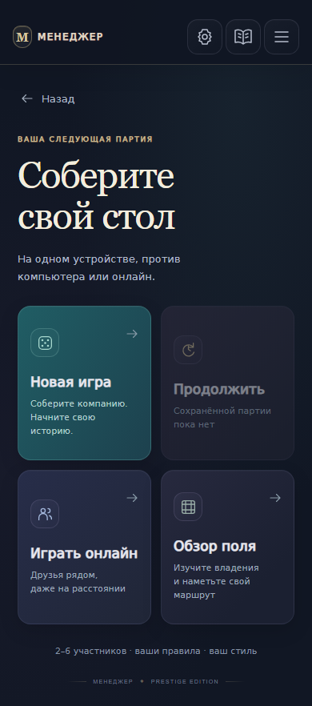

# Приёмка после Stage 1 — обновлено 25 ноября 2026

## Актуальное изменение: Manager Prestige Edition

25 ноября переработаны только главное меню, экран «Играть» и их шапка. Общие источники: `ui/menu.html`, `ui/shell.css`, минимальное представление `ui/shell.js`; `index.html` обновлён существующим генератором. Повторно использован прежний WebP игрового мира, без новых библиотек и постоянных Canvas-циклов. Темная сине-графитовая основа, аметистовые карточки, шампанское золото, бирюзовое главное действие и композиция поля/фишки/кубика/владения. Вся функциональность магазина осталась прежней.

`bridge.hasMatch()` и существующий guarded continue не изменены. При отсутствии сохранения карточка «Продолжить» отключена и сообщает об этом; при настоящем сохранении включается. Данные партии, уровни, валюты и показатели не выдумываются. Маршруты new/continue/online/explore/settings/rules/shop/more прежние. Только data-view переключает оформление двух меню.

**Текущий целевой QA: 19 PASS / 0 FAIL** — 10 экранов/размеров, 6 сценариев Web и Telegram-fixture, 3 presentation-теста. Визуальная матрица: 320×568, 390×844, 430×932, 768×1024, 1440×1000; оба меню. Проверены отсутствие горизонтального скролла/обрезания кнопок, касания ≥44×44, шапка без наложений, simulated safe areas и prefers-reduced-motion. Онлайн-карточка открывает прежний диалог. Регрессия проверила все пункты меню, новую партию, реальное сохранение, продолжение после reload, бросок, обзор владений «Отдыха» и масштаб 50–250%. Исправлены узкий min-content grid и выход декоративных орбит; для reduced motion выключен также переход шапки.

Существующие генераторы UI/Web/Telegram выполнены после оформления и затем после точечных исправлений; повторные 12 CI и неизменённые 84 теста не запускались. Предыдущие результаты ниже относятся к прежнему SHA `a3279b0`; они не объявляются CI нового меню. Новый UI проверен целевым циклом выше. При программной сверке `index.html` за пределами двух manager-shell блоков полностью совпадает с предыдущим коммитом; игровой код, правила, RNG, экономика, сеть, магазин, платежи и сохранения не изменены.

Это Chromium и синтетический Telegram SDK: не физические Android/iPhone, не новый интерфейс в настоящем Telegram Desktop/WebView, не Safari/macOS/Windows native QA. Ранее наблюдавшаяся настоящая Telegram-партия использует старый изолированный кандидат; она не считается проверкой нового оформления. VPS, Docker, Caddy, бот, production и PeerServer не менялись; merge/deployment не выполнялись. Прежние внешние BLOCKED остаются в силе.

## Проверяемая пара

- Игра: [PR №7](https://github.com/zabbarov13-star/manager-game/pull/7), проверенный исполняемый код `a3279b0a1f1b697f8662a2b911eadd9dc9b92425`. На момент сверки HEAD `4c893f0abe94aa93df773f16d101d27de723f07f` отличался только документацией и результатами QA. Текущее продолжение добавляет только тест распакованного кандидата и документацию; runtime неизменён.
- Сигналинг: [PR №1](https://github.com/zabbarov13-star/manager-peer-server/pull/1), HEAD и проверенный код `536009173cf47ba47687777548d7dc161d7de30e`.
- [Сверка Git-объектов и возможностей автоматизации](post-stage1-compatibility.json). После успешных CI runtime и зависимости не менялись. Успешные CI, сборки и прежний общий QA не повторялись. Выполнен только недостающий целевой прогон распакованных архивов; два успешных локальных этапа переиспользованы.

## Автоматически подтверждено

Уже поставленный повтор iOS №2 завершился **PASS**: [задание](https://github.com/zabbarov13-star/manager-game/actions/runs/45425055784/job/138571180868). Runner выделен, приложение дважды запущено в Simulator; оба запуска показали `native=true`, `menu=true`, сохранение `persisted`, второй запуск прочитал предыдущий маркер. Это не физический iPhone и не Telegram iOS. Первый инфраструктурный CANCELLED сохранён в истории; новых повторов в этом продолжении нет.

Итого для исполняемого SHA `a3279b0`: **12 проверочных заданий PASS, deploy SKIPPED**. [Статусы и iOS-доказательство](unified-ci.json). Ранее полученные 84 unit/integration PASS и остальные успешные задания переиспользованы; один namespace SKIP обычного процесса покрыт отдельным успешным изолированным запуском на синтетических данных. [18 шагов общего QA](unified-qa.json). У сигналинга оба имеющихся запуска контрактного теста на SHA `5360091` успешны; они не повторялись.

## Совместимость контрактов

| Контур | Сверка | Вывод |
|---|---|---|
| PeerJS HTTP/WebSocket | Сохранились HTTP `/peerjs/peerjs/id`, WebSocket `/peerjs/peerjs`, стандартный key `peerjs`, обмен OFFER/ANSWER/CANDIDATE | Клиент и сервер совместимы по проверенному контракту. HTTP ID не является проверкой прав; неверный WS key отвергается |
| Запуск PeerServer | Diff к `f48fc02`: фабрика и `require.main`, прежние настройки ExpressPeerServer и `node server.js`; в scripts добавлен только test | Изменения игры не требуют предварительного изменения production-сигналинга. Фактическая установленная ревизия внешнего сервера здесь не устанавливалась |
| Игровые команды | Runtime игры идентичен `a3279b0`: прежние токены, requestId, gameRevision, Idempotency-Key, replay | Результаты ранее успешной регрессии и восстановления применимы; повторного исполнения тестов не было |
| Косметика и анимации | Проверка прав остаётся в Telegram/общем игровом сервере; actorId/cosmeticStyle/cosmeticDice необязательны; локальные фазы не передаются по сети | PeerServer только пересылает сигналинг, не выдаёт права и не хранит SQLite; wire-контракт не связывает его с новым каталогом |
| Сеть | Сетевые исходники не изменены относительно внешнего успешного прогона; [предыдущее доказательство](unified-network-source.json) | Реальный внешний PeerJS/WebRTC уже подтверждён двумя браузерными контекстами на одной машине; это не разные мобильные сети |

Это сверка пары исходников и доказательств CI, а не приёмка установленного VPS. Оба PR на момент проверки GitHub помечал MERGEABLE; отсутствие конфликтов само по себе не означает готовность выпуска.

## Что подтверждено вручную

После ручного нажатия пользователем тестовой кнопки подтверждён **PASS открытия главного меню в настоящем Telegram Desktop**: отдельное окно Mini App, origin совпадает с частной конфигурацией стенда, видны меню и кнопки «Играть», «Настройки», «Правила», «Магазин». Пользователь затем создал тестовую партию и сделал ход; UIA подтвердил поле, результат `2 + 3 = 5`, фазу покупки и индикатор локального сохранения. Это **PASS наблюдения реального хода**, но не доказательство восстановления после перезапуска, серверной авторизации, премиальных прав или сетевой партии в настоящем Telegram. Ручной анализ изменения PeerServer подтвердил сохранение маршрутов и настроек; это статический review.

Средствами Computer Use проверен установленный Telegram Desktop на Windows: приложение открылось, целевое окно и дерево доступности UIA доступны. Это автоматизированная проверка возможности управления настоящим клиентом, а не PASS Mini App. Личные чаты, initData и сессии в артефакты не переносились.

## Следующая реальная приёмка и блокировки

[Отдельный компактный сценарий](TELEGRAM-MANUAL-CHECKLIST.md) покрывает Desktop, Web и физические Android/iPhone, права обычного игрока/владельца, предпросмотр, игру, чат, сохранение, фон и переключение сети.

Изолированный временный HTTPS-стенд подготовлен из существующего CI-артефакта без сборки. Дерево merge-коммита `92bced50a6c533e6773343f8aef053eaecc218f7` совпадает с деревом проверенного `a3279b0` (`cad89ff49e90445e0f77dbc36f15392feb1282c4`). Проверены оба SHA-256, tar-пути/ссылки, отсутствие рабочих env/SQLite и соответствие распакованных файлов архивам.

| Новая доступная проверка | Результат и границы |
|---|---|
| Локальный стенд | PASS: отдельные Node 24, adapter-only 18443, verifier 18444, rooms 18480; новые тестовые SQLite, без VPS/Docker/служб |
| Публичный HTTPS и защита | PASS: доверенный TLS, анонимно 403, gated provenance/health 200; внутренние маршруты 404. Не Telegram WebView |
| Изоляция данных | PASS для окончательных путей: новые БД, таблицы профилей/покупок/ads/rooms/replay пусты; действующие БД не открывались |
| Бот | PASS: getMe подтверждает TestBot; разрешённая персональная кнопка изменена и прочитана обратно, глобальная не менялась; откат сохранён |
| Telegram Desktop | PASS открытия: пользователь нажал тестовую кнопку, Mini App показал главное меню на подтверждённом origin. Дальнейший прогон BLOCKED: click API возвращает `coordinate input geometry is unavailable`; Tab/F6 после активации не перевели фокус с панели в WebView. Пользователь сделал ход, UIA наблюдал `2 + 3 = 5`; серверная авторизация, права и восстановление в реальном клиенте не подтверждены |
| Telegram Web | BLOCKED: существующая авторизованная сессия не подтверждена; новую авторизацию не выполняли |
| Физический Android | BLOCKED: официальный portable ADB, контрольная сумма PASS; отдельный adb devices дал 0 устройств во всех состояниях |
| Второй аккаунт, iPhone | BLOCKED: не подтверждены. iPhone не искался; пароли/коды не запрашивались |

Исправлены только настройки нового стенда: формат отключения autosave Caddy и явный UTF-8 для env-путей Windows. Первые тестовые Node-процессы остановлены; ошибочно созданные ими новые пустые тестовые SQLite в соседнем пути проверены read-only и оставлены без удаления. Рабочие игровые данные не затрагивались. Ожидание HTTP 200 от GET комнаты без кода исправлено в сценарии на штатный 400; это не исправление runtime игры.

Готовый локальный пакет `release-output/final-acceptance/manager-acceptance-a3279b0.zip` — 44,881,286 байт, SHA-256 `49473025215ec2489813bb3118efcbdd7210ef5da76e5e993319530a75baa908`. Содержит оба исходных runtime-архива и манифесты, без секретов. Частные access/menu-backup/env и сведения процессов находятся вне Git. Для остановки подготовлен `stand/Stop-Own-Test-Processes.ps1`, проверяющий PID, executable и время старта; он не запускался. `restore_test_menu.py` возвращает только сохранённую персональную кнопку TestBot; также не запускался.

Не завершена полная приёмка настоящих Telegram WebView; не проверены физические устройства, отдельные WAN/NAT и реальное переключение мобильной сети, ручная художественная/UX-приёмка, целевая установленная VPS-ревизия. Финансовые/рекламные интеграции этой работой не включались и не принимались; их прежние ограничения остаются. Нативные smoke не подтверждают премиальный Telegram-каталог вне Telegram-адаптера.

## Итоговый инкрементальный прогон распакованного кандидата

**7 PASS / 0 FAIL**: два ранее успешных локальных этапа переиспользованы, пять сетевых этапов завершены на новых memory-only БД. Источник и полные обезличенные результаты — в `post-stage1-compatibility.json`, поле `packagedAcceptance`. Новая команда: `QA_PACKAGED_ROOT=<проверенный распакованный стенд> node ui/tests/packaged-acceptance.cjs`; при необходимости указать существующий Chromium через `QA_BROWSER`. `QA_PACKAGED_ONLINE_ONLY=1` переиспользует уже записанные локальные PASS того же SHA. Повторных сборок/CI нет.

| Этап | Результат | Область |
|---|---|---|
| Меню → настройки → правила → магазин | PASS, переиспользован | Распакованный adapter-only, 18 карточек, без оплаты |
| Локальная партия → бросок → закрытие/открытие | PASS, переиспользован | Точное равенство сохранённого состояния |
| Два клиента → общая комната → готовность → старт → ход | PASS | Один общий сервер комнат из rooms-архива; синтетические Telegram identities |
| Чат → уведомление → прочтение | PASS | POST с Origin прокси-стенда и UUID v4, сообщение видно другому клиенту, badge появляется и снимается |
| Перезагрузка гостя | PASS | Автовосстановление поля, виден премиальный образ другого игрока |
| Offline → ошибка соединения → online → синхронизация | PASS | Браузерная сеть отключена, наблюдались reconnecting → connected; одинаковое game, rolls=1, образ сохранён. Это не смена мобильной сети |
| Платежи/реклама/ошибки | PASS | Orders=0, ads=0, uncaught page errors=0; внешние браузерные запросы заблокированы |

Первичная причина HTTP 400 чата подтверждена кодом и фактическим статусом: тест передавал 32 hex-символа вместо обязательного UUID v4 в `Idempotency-Key`. Добавление Origin само по себе этот отказ не исправляло. Теперь запрос содержит правильный Origin текущего изолированного прокси и `randomUUID()`; отрицательная проверка по-прежнему получает 400 для неверного ключа. Серверная защита не менялась.

Устранены также ошибки тестового сценария: ожидание закрытия асинхронно обновляемого lobby перед кликом по игровому полю; совместное ожидание ответа и клика без unhandled rejection; проверка состояния соединения по `data-state`, поскольку элемент находится внутри закрытого диалога и не обязан быть видимым. Это исправления QA, не подтверждённые дефекты runtime.

Оставшиеся запрошенные проверки покрыты неизменёнными успешными результатами: все режимы/правила и экономика — прежними unit/integration и browser-matrix; центр/масштаб/камера/строительство — board-gestures-construction; движение и карточки «Отдых», «Сюрприз», «Извещение» — browser-matrix и local-motion-pixels; 108 событий и 48 локальных фаз, оформление бросающего — animation/multiplayer и character-field. Эти сценарии повторно не исполнялись. Холодное меню packaged-fixture ранее измерено в 835 мс, DOMContentLoaded 470.8 мс; это не измерение настоящего Telegram или медленной сети.

**7 внешних BLOCKED** отдельно от семи автоматических PASS: (1) полный реальный Telegram Desktop WebView, (2) Telegram Web с разрешённой сессией, (3) физический Android, (4) физический iPhone, (5) второй реальный аккаунт/межсетевой прогон, (6) реальная Stars/AdsGram-приёмка, (7) установленная VPS-ревизия и production-приёмка. У Desktop нет геометрии ввода и CDP-порта; ADB ранее показал 0 устройств. Блокировки не подменены эмуляцией и не требуют промежуточных ручных действий в рамках этого продолжения.

## Готовность к слиянию

| PR | Вывод |
|---|---|
| manager-peer-server №1 | **Технически готов к слиянию по проверенному контракту**: SHA совпадает, CI PASS, изменения изолированы. Оставлен draft; merge/deployment не выполнялись |
| manager-game №7 | **Не готов к окончательной приёмке/слиянию**: автоматический барьер закрыт, реальная Telegram/физическая и художественная приёмка остаётся BLOCKED. Оставлен draft |

Runtime игры не менялся; в репозитории изменены только QA-сценарий, документация и QA-статусы. Локально созданы отдельные тестовые процессы, переносимые инструменты и новые тестовые данные. По разрешению изменена только персональная menu-кнопка TestBot. VPS, Docker, рабочий Caddy, рабочие базы, платежи, webhook, polling и /start не менялись. Для будущего разрешённого развёртывания нужны архивы точного принятого SHA, свежий изолированный GO и резервная копия; прежний GO не переносится на новый кандидат автоматически.
